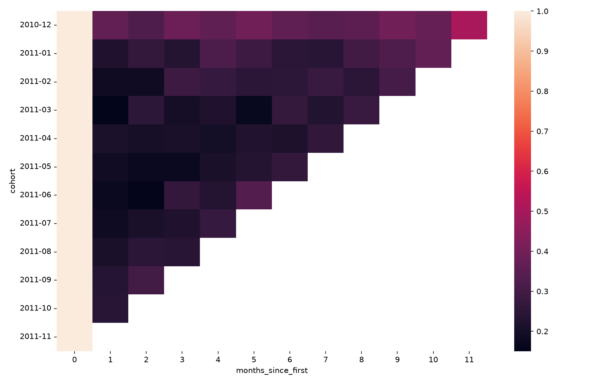

# Do Your Customers Come Back? Building a Retention Heatmap in Seaborn

*Nathan McCauley · STAT 386 · October 2026*

I'm studying product management, and one of the first things I learned is that growth numbers can be misleading. A store's total orders can go up every month even if most new customers buy once and never come back. New customers just cover up the ones you lost.

To see whether people actually stick around, product teams track **retention**. A common way to show it is a cohort retention heatmap. In this post I'll walk through building one with pandas and seaborn, and then how to read it.

## Cohorts and retention

A **cohort** is a group of customers who started at the same time. In this post, a cohort is everyone whose first order was in the same month. Retention for cohort $$c$$ in month $$m$$ is:

$$
\text{Retention}_{c,\,m} = \frac{\text{customers in cohort } c \text{ who order } m \text{ months after their first order}}{\text{customers in cohort } c}
$$

So if 100 people placed their first order in January and 20 of them ordered again in February, January's retention in month 1 is 20%. Month 0 is always 100%, since everyone orders in their first month.

## The data

I used the [UCI Online Retail dataset](https://archive.ics.uci.edu/dataset/352/online+retail), which has every purchase from a UK online gift shop. I cut it down to one row per completed order by removing orders with no customer ID, cancelled orders, and December 2011 (the data stops partway through that month). That leaves 17,758 orders from 4,298 customers between December 2010 and November 2011.

```python
import matplotlib.pyplot as plt
import pandas as pd
import seaborn as sns

url = "https://raw.githubusercontent.com/nmccaul/tutorial_blog/main/posts/data/orders.csv"
orders = pd.read_csv(url, parse_dates=["order_date"])
orders.head()
```

| customer_id | order_date |
|------------:|:-----------|
| 17850 | 2010-12-01 |
| 17850 | 2010-12-01 |
| 13047 | 2010-12-01 |
| 13047 | 2010-12-01 |
| 13047 | 2010-12-01 |

You only need an ID and a date, so the same steps work for app logins, gym check-ins, or anything similar.

## Step 1: Build the cohort table

First, turn each date into a month and find each customer's first month:

```python
orders["order_month"] = orders["order_date"].dt.to_period("M")
orders["cohort"] = orders.groupby("customer_id")["order_month"].transform("min")
```

I used `transform` instead of `agg` because `transform` keeps every row. Each order gets tagged with its customer's cohort instead of the data collapsing to one row per customer.

Next, count how many months after their first order each order happened. Subtracting two periods gives an offset, and `.n` turns it into a number:

```python
orders["months_since_first"] = (orders["order_month"] - orders["cohort"]).apply(
    lambda offset: offset.n
)
```

Last, count the customers active in each cohort and month, and divide by the cohort's size:

```python
active = (
    orders.groupby(["cohort", "months_since_first"])["customer_id"]
    .nunique()
    .unstack()
)
cohort_size = active[0]
retention = active.div(cohort_size, axis=0)
```

`nunique()` counts each customer once per month even if they ordered several times, and `unstack()` turns the months into columns. Column 0 holds each cohort's size, so dividing by it gives percentages. Here's the top-left corner:

| cohort  | 0    | 1   | 2   | 3   |
|:--------|:-----|:----|:----|:----|
| 2010-12 | 100% | 37% | 32% | 38% |
| 2011-01 | 100% | 22% | 27% | 23% |
| 2011-02 | 100% | 19% | 19% | 28% |
| 2011-03 | 100% | 15% | 25% | 20% |

The full table has 144 numbers, which is too many to scan. Patterns are a lot easier to spot as colors.

## Step 2: Plot it with `sns.heatmap`

The quickest version is one line:

```python
sns.heatmap(retention)
```



This is hard to read. There are no numbers, darker means *lower*, and the month 0 column (always 100%) stretches the color scale so much that everything else looks about the same. A few arguments fix it:

```python
fig, ax = plt.subplots(figsize=(11, 7))
sns.heatmap(
    retention,
    annot=True,
    fmt=".0%",
    cmap="Blues",
    vmin=0,
    vmax=0.5,
    cbar_kws={"label": "Share of cohort ordering again"},
    ax=ax,
)
ax.set_title("Monthly retention by first-order cohort")
ax.set_xlabel("Months since first order")
ax.set_ylabel("Cohort (month of first order)")
plt.show()
```

- `annot=True` and `fmt=".0%"` print each value as a percentage.
- `cmap="Blues"` is a *sequential* palette, so darker simply means more customers came back.
- `vmin=0` and `vmax=0.5` cap the color scale at 50%, so the colors show differences between the cells that matter instead of being used up by month 0.
- The labels and title explain the chart without the code.


## Step 3: Read the heatmap

I read this chart in four directions:

- **Across a row** shows one cohort over time. January 2011 drops to 22% in month 1 but is back up to 36% by month 10, so people who return tend to keep returning.
- **Down a column** compares cohorts at the same age. In month 1, December 2010 kept 37% of its customers, and every later cohort kept 15–24%.
- **Along a diagonal** shows the same calendar month. The last cell in most rows is November 2011, and it's usually the highest in its row. That's holiday shopping, not better loyalty.
- **The empty triangle** isn't missing data. Newer cohorts just haven't been around long enough.

Be careful with the December 2010 cohort. The data starts on December 1, 2010, so that cohort includes long-time customers whose real first order was earlier. That's probably part of why it looks so loyal, so check where your data starts before reading too much into the first cohort.

## Try it yourself

To recap: label each customer's cohort, count months since their first order, divide by cohort size, and plot it with `sns.heatmap`.

Try running this code on a dataset with an ID and a date, like your final project data. You can also change `"M"` to `"W"` in `.dt.to_period("M")` to get weekly cohorts and see how the picture changes.

For more detail, see [seaborn's `heatmap` documentation](https://seaborn.pydata.org/generated/seaborn.heatmap.html) and the [pandas guide to `groupby` and `transform`](https://pandas.pydata.org/docs/user_guide/groupby.html).

<script src="https://cdn.jsdelivr.net/npm/mathjax@3/es5/tex-mml-chtml.js"></script>
